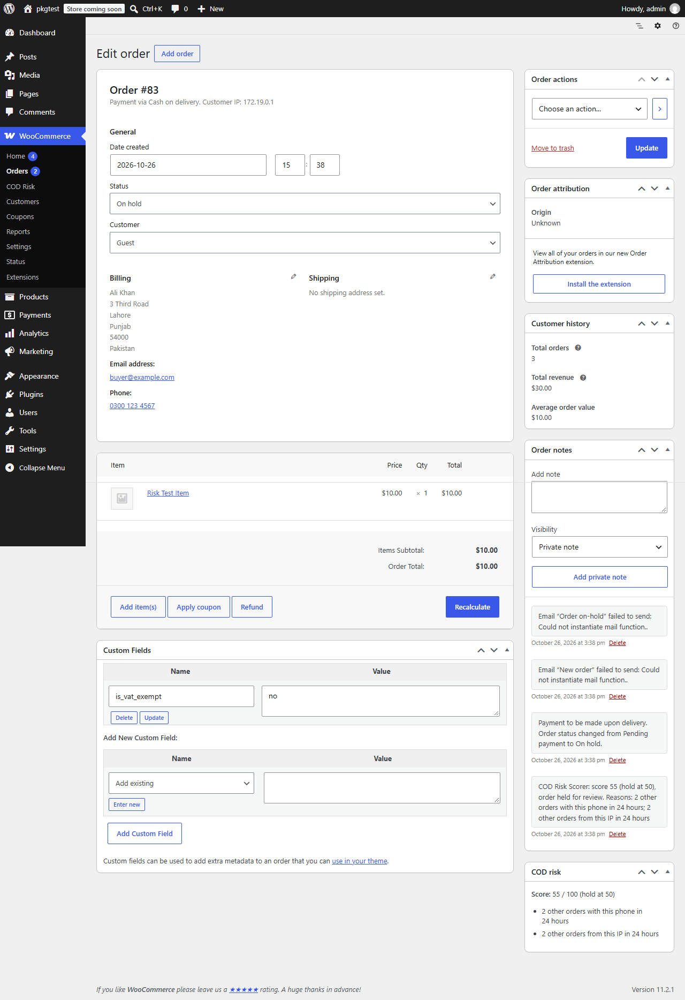

# COD Risk Scorer

Scores cash-on-delivery WooCommerce orders for fraud risk and holds suspicious ones. Free, local, no SMS provider.

    



## Features
- 0-100 risk score for every COD order, with the reasons listed on the order screen.
- Signals: phone, IP and address velocity; earlier cancelled/failed/refunded orders; blocklist.
- Orders at or above your threshold (default 50) are set to **On hold** with an order note.
- Hook for your own one-time-password check (`codrisk_otp_verified`). No SMS provider bundled.
- Works with the checkout block and classic checkout. HPOS and legacy order storage both tested.
- Phone, IP and address are stored only as salted hashes in order meta. No external requests.

## Installation
**Zip:** upload the release zip under Plugins > Add New. **Manual:** copy `cod-risk-scorer` to `wp-content/plugins/`. WooCommerce must be active.

## Usage
WooCommerce > COD Risk: set the hold threshold and (optionally) a blocklist, one phone, email or IP per line. Scored orders show a **COD risk** box on the order screen.

## WP-CLI
None: the plugin has no commands.

## Hooks
See [docs/hooks.md](docs/hooks.md) for the filters and the scoring table.

## FAQ
**Which orders are scored?** Orders paid with WooCommerce's built-in Cash on Delivery gateway.
**Can a score be wrong?** Yes. It is a heuristic: families sharing a phone or address can trip the velocity rules. Held orders are only On hold; nothing is cancelled.
**Why are many orders flagged for the same IP?** Behind a proxy or CDN (for example Cloudflare) WooCommerce may record the proxy's address for every customer. Make your host or CDN pass the real visitor IP to PHP, or raise the threshold. The IP signal is worth at most 30 points.
**Does it store personal data?** Salted hashes of phone, IP and address in order meta, plus the score. They are removed on uninstall and when the order is deleted.

## Development
```bash
composer install
composer lint && composer stan && composer test:unit
npx @wordpress/env start
```
The WordPress suite needs WooCommerce in the test site. Set `CODRISK_HPOS=1` to run it on High-Performance Order Storage. See [TESTING.md](TESTING.md).

## Roadmap
Country and postcode rules, order-value rules, one-click "add to blocklist" from the order screen, bundled OTP integrations.

## Contributing
See [CONTRIBUTING.md](CONTRIBUTING.md). Security: [SECURITY.md](SECURITY.md).

## License
GPL-2.0-or-later.